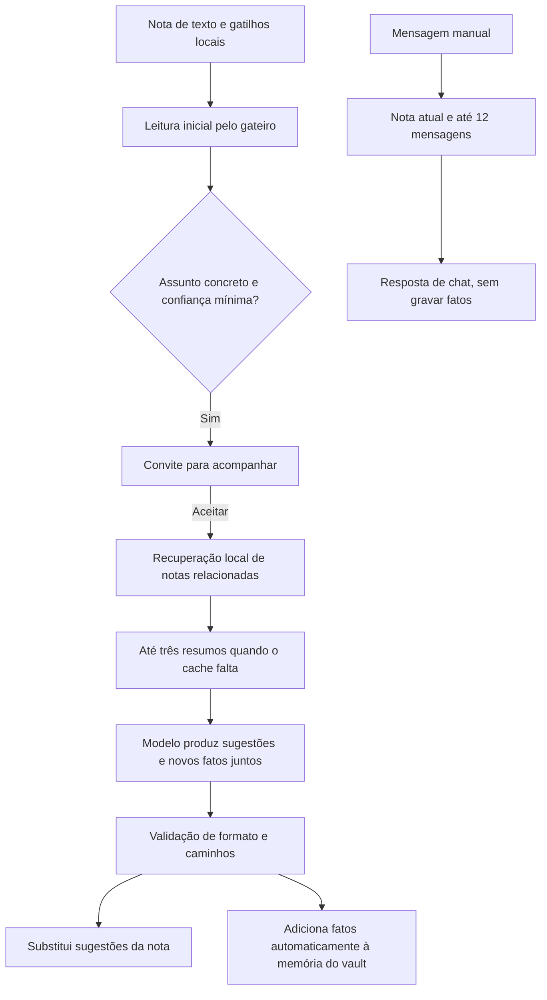

# Análise — atividade, novidades e decisões de memória do agente

## Escopo e estado

**Atualização após autorização:** a primeira etapa do plano 19 foi implementada:
atividade por operação, novidades independentes nas abas, primeiro ciclo de aceite,
seleção de fatos inteiros por relevância/recência, limite por item, prompt mais restritivo,
igualdade normalizada e origem/data. O diagnóstico abaixo registra o código **antes**
dessa implementação. Memória estruturada, revisão de paráfrases e integração ao chat
permanecem na segunda etapa. Nenhuma limpeza de fatos antigos foi executada.

Análise do código atual após os quatro prints enviados pelo dono. Luna 6 high investigou
prompts/memória/contexto; Luna 6 medium investigou atividade e feedback. Auditoria somente
leitura. A coordenação implementou apenas o pedido direto de remover a linha com o nome
da nota em `PainelAgente.tsx` e atualizou `docs/11-agente-ia.md`.

As melhorias comportamentais abaixo são propostas, ainda não implementadas. Nenhuma memória
existente foi apagada, fundida ou regravada, nem foram consultados dados pessoais em disco.

## Como a IA funciona hoje

### Gatilhos e participação

- `gatilhos.ts`: nota com pelo menos 140 caracteres e 5 s de inatividade pode ir ao gateiro.
  Participação prévia, pausa e chamada em andamento limitam esse caminho.
- `gateiro.ts`: modelo recebe os primeiros 2.000 caracteres e decide se há assunto concreto
  que permite ajudar. Convite exige `valeParticipar` e confiança >=0,5. Essa confiança vale
  somente para convidar; não valida sugestões ou aprendizados.
- `agenteStore.responderConvite`: aceitar dispara uma tentativa imediata de ciclo. A regra
  desse ciclo ainda exige 200 caracteres novos. Portanto um convite aceito em nota de
  140–199 caracteres pode não produzir nada nessa tentativa.
- Acompanhamento posterior usa 10 s de inatividade e 200 caracteres novos. Alterações de
  linhas contam como texto novo; não é um pedido por tecla. Ao abrir vault, a referência
  do último ciclo é resetada; ela não é uma lembrança persistente do que já foi analisado.

### Contexto e chamadas

| Caminho | O que recebe | O que decide/grava |
|---|---|---|
| Gateiro | Começo da nota (2.000 caracteres) | Tema, confiança, convite |
| Recuperação | Busca local, links e backlinks | Notas relacionadas; sem busca na internet |
| Resumos | Até três notas sem cache válido, primeiros 6.000 caracteres | Cache de resumo; não são fatos duráveis |
| Acompanhamento | Fim da nota (6.000), diff (1.200), notas relacionadas/resumos, fatos (4.800) | Até quatro sugestões e dois fatos |
| Chat manual | Começo da nota (6.000) e últimas 12 mensagens da conversa | Resposta; não recebe fatos nem grava memória |

Um ciclo pode fazer até quatro pedidos ao modelo: três resumos e a resposta principal.
Isso pode explicar parte da demora observada, mas os prints não permitem atribuir a
latência específica a cada pedido. Extração de memória não é outra chamada separada.
Pesquisa web não está implementada: não há ferramenta de busca no transporte atual e
`interpretarCiclo` descarta `achadoWeb`. Um indicador “Pesquisando na web…” seria incorreto.

## Problemas confirmados

### 1. Atividade não representa operações reais

`status` é global. Gateiro, ciclo e chat colocam `pensando`; a conclusão de um pode voltar
para o estado base enquanto outro continua. `emVoo` é por nota e o chat tem bloqueio
próprio, portanto essas operações podem se sobrepor. Não existem estados separados para
recuperação local, resumos e geração de sugestões. O spinner da conversa manual não
representa todo o trabalho de acompanhamento. `observando` existe no tipo, mas não é emitido.

### 2. Abrir Conversa oculta novidades das outras abas

Na entrega anterior, `marcarAtualizacao` suprime novidades da nota quando o painel está
aberto; `reconhecerAtualizacoes` reconhece a abertura do painel inteiro. Essa regra é
insuficiente para abas: abrir Conversa não significa consultar Sugestões ou Memória.
Memória nem sequer participa das flags atuais. Mudar o total disponível não substitui um
indicador de novidade, principalmente com FIFO mantendo o total em 100.

### 3. Memória sem critério verificável de qualidade

`systemAssistente` pede “observações duráveis sobre o autor/vault”, com um exemplo de
termo usado pelo autor. Não distingue preferência, convenção, resumo de projeto,
estado temporário, estimativa ou inferência. Não exige evidência nem fonte específica.
Qualquer lista de strings parseável pode ser gravada automaticamente, inclusive quando
não há sugestões. Limites são quantidade, formato e texto não vazio; não há teto de
comprimento individual, classificação, atualização, contradição ou relevância.

O exemplo do print é principalmente um resumo de acompanhamento de projeto com valor
estimado. É candidato fraco a memória durável do autor; deveria permanecer no contexto da
nota/projeto, sujeito a atualização. Já existem resumos por nota para parte desse papel.
Isso é uma recomendação de produto, não um filtro já existente no código.

### 4. Dedupe rejeita apenas igualdade exata

`memoria.adicionarFatos` faz `trim`, compara textos com `Set` e anexa os que diferem. O
trecho “na própria nota de status” difere de “na própria nota”; assim a mesma ideia do
print pode ser gravada duas vezes. A função não compara significado, entidades, valores
ou negações. Não existe reconciliação dos fatos anteriores.

Além disso, os 100 fatos mais recentes são mantidos por FIFO, mas a seleção para o prompt
concatena em ordem antiga→nova e corta **os primeiros** 4.800 caracteres. Isso privilegia
os fatos antigos dentro da lista preservada, contrariando o “mais recentes” documentado
em `docs/11-agente-ia.md`. O corte também pode quebrar um fato no meio. Um fato muito longo
pode dominar esse orçamento. Fatos fora do recorte não são vistos pelo modelo, embora
continuem armazenados.

### 5. Continuidade desigual entre chat e acompanhamento

O chat não recebe memória, sugestões anteriores ou notas recuperadas; o acompanhamento
não recebe histórico do chat. Assim, uma preferência informada no chat não vira
aprendizado e a IA do chat pode desconhecer o que a aba Memória exibe. A inclusão dessa
memória no chat exige selecionar o que é relevante; enviar tudo aumentaria contexto e
consumo sem corrigir qualidade.

## Melhorias recomendadas

### Prioridade 0 — feedback confiável

1. Registrar operações por ID, geração do vault e nota: `leitura-inicial`,
   `buscando-notas-relacionadas`, `preparando-contexto`, `gerando-sugestoes`, `respondendo`.
   Começo/fim reais, com limpeza em `finally` e descarte de operações antigas. Uma
   operação terminada não pode apagar a atividade de outra.
2. Exibir uma linha discreta de atividade, visível em qualquer aba. Textos como
   **Analisando a nota…**, **Consultando notas relacionadas…**, **Preparando sugestões…**
   e **Respondendo…**. Sem porcentagem, progresso inventado ou indicação de pesquisa web.
   Quando não existe pedido ativo, não deixar um spinner ligado ao timer de espera.
3. Sugestões: ponto/realce de novidade por nota e versão do lote. Memória: ponto/realce
   por vault e versão de inclusões reais. Reconhecer uma aba somente ao selecioná-la,
   usando a versão mostrada; novo resultado posterior volta a avisar. Não trocar aba,
   mover foco ou emitir toast a cada ciclo.
4. O balão mantém o significado “atualizações desde a abertura”. Avisos das abas são
   independentes: abrir Conversa limpa o aviso externo de consulta, mas preserva os
   pontos de Sugestões/Memória até suas abas serem consultadas.
5. Primeiro aceite: distinguir ciclo inicial de ciclo por edição. Proposta: garantir uma
   análise inicial de nota não vazia, sem exigir 200 caracteres de diff, mantendo pausa,
   identidade, teto, autenticação, uma chamada em voo e espera de erros existentes.
   Não remover o limiar dos ciclos seguintes nem provocar pedidos repetidos sem mudança.

### Prioridade 1 — impedir acúmulo e melhorar contexto

1. Corrigir seleção para fatos inteiros, com limite por item e orçamento total de
   caracteres. Priorizar relevância e, no desempate, recência. Não cortar frase no meio.
   Comparar candidatos contra toda a memória preservada, não apenas o recorte enviado.
2. Tornar o prompt restritivo: preferências explícitas, glossário, convenções e contexto
   estável do vault. Status de ticket, prazo, valor estimado, resumo da nota, observação
   óbvia e variação só de maiúsculas não devem virar aprendizados duráveis. Lista vazia
   é a saída normal quando não há informação nova.
3. Primeiro dedupe local de alta precisão: Unicode/ espaços/caixa para comparação,
   preservando original e acentos. Não apagar palavras, números, moedas, datas ou negações.
   Paráfrases próximas devem virar **candidatas a revisão**, não exclusão automática.
   Evitar adotar um limiar de similaridade sem conferir falsos positivos do domínio.
4. Mostrar origem e data, que já existem em `Fato`. Uma remoção continua afetando apenas
   o aprendizado selecionado. Duplicatas existentes precisam de revisão recuperável;
   não fazer limpeza automática em lote da memória do dono.

### Prioridade 2 — memória com evidência e continuidade

Propor fatos estruturados com categoria, fonte e trecho de evidência verificável no
material efetivamente fornecido. O app valida fonte/trecho; confiança declarada pelo
modelo não é prova. Candidatos incertos, semelhantes ou contraditórios ficam fora do
contexto durável até revisão. Valores, entidades, negação e modalidade divergentes não
podem ser fundidos. Preservar formato antigo na leitura e planejar compatibilidade antes
de mudar persistência.

Depois, o chat recebe a mesma seleção relevante de memória. A gravação de preferências
vindas do chat precisa de regra explícita e visível; não extrair indiscriminadamente
toda mensagem. Não acrescentar embeddings, serviço externo ou outra chamada ao modelo
por sugestão para iniciar essas melhorias.

## Evidências e limites

Referências: `src/agente/{gatilhos,gateiro,assistente,memoria}.ts`,
`src/estado/agenteStore.ts` (`agendar`, `rodarGateiro`, `rodarCiclo`, `enviarMensagem`,
`responderConvite`, `marcarAtualizacao`), `src/ui/excalisidian/PainelAgente.tsx`,
`src/types/atualizacoes-agente.ts`, `docs/11-agente-ia.md` §§2.2/5/6.

A análise verifica decisões expressas no código e prompts; não acessa raciocínio interno
do modelo, não demonstra exatidão dos fatos do print nem mede a latência da sessão.
Remoção do nome da nota: suíte completa 1.588 testes/131 arquivos e build aprovados.
O resultado da execução posterior e seus checks estão no plano 19 e na passagem de
feedback/memória; a segunda etapa permanece pendente.
